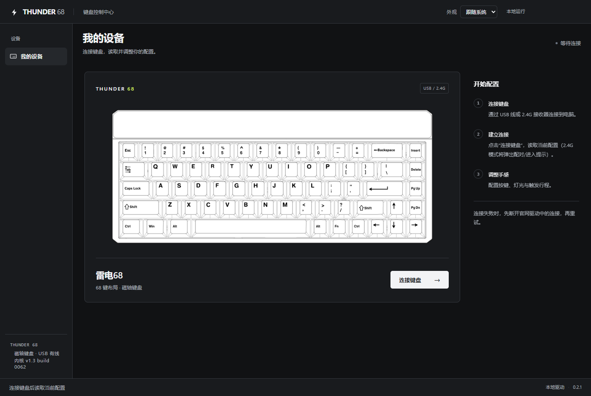

[English](README.en.md) | [简体中文](README.md)

# Thunder68 Local Driver (Personal Offline Edition)

A personal offline Electron desktop companion wrapper for the official DAREU Thunder68 WebHID configurator, offering strict offline isolation, flicker-free persistent themes & window geometry, USB wired & 2.4G wireless dongle support, a local profile snapshot & Diff library, a self-authored offline key & magnetic-switch feel tester, hot-plug auto-detection with a sanitized diagnostics center, and system-tray residency with global shortcuts.

> **Scope & Licensing Notice**: This project is **not** an official DAREU Windows driver, does not install or replace any OS driver, and does not craft custom low-level HID write packets. The configuration UI and WebHID protocol come from `https://oem.dareu.com/thunder68` (first captured on 2026-10-06 for personal offline use). The public repository, CI workflows, and Releases **never** bundle or redistribute official vendor assets or packaged binaries containing them. See [THIRD_PARTY_NOTICES.md](THIRD_PARTY_NOTICES.md).

---

## Interface Preview



*Offline desktop control center main screen (device view, companion tools rail, and dark / system theme).*

---

## Quick Start (Portable Build)

1. Double-click `release/Thunder68-Local/Thunder68-Local.exe`. Keep the folder intact (move it to a fixed directory before enabling auto-launch; no Node.js, browser, or internet connection required).
2. Connect your Thunder68 via **USB cable** or **2.4G wireless dongle**, then click **Connect Keyboard (连接键盘)**.
   - **Hot-Plug Auto-Detection**: Plugging in or waking a Thunder68 while disconnected shows a non-intrusive floating bar with one-click reconnect (never hijacking an active session).
   - **Precision Troubleshooting**: Connection issues are classified into *No Device Detected / Bluetooth Mode Unsupported / Unsupported Same-Vendor Model / Handle Occupied by Web Configurator or Another Process / HID Communication Failed* with tailored steps, plus a slide-over **Diagnostics Center (连接诊断)** with one-click sanitized report copy.
   - **Multi-Device & 2.4G Support**: Multiple Thunder68 interfaces open a clear picker dialog; 2.4G pairing modals stay centered and connection mode + 2.4G battery percentage appear in the sidebar, header, and tray menu.
3. Use the official configuration pages or the **Companion Tools (伴侣工具)** in the left rail:
   - **Local Profile Library (配置方案库)**: Capture clean 68-key snapshots (volatile runtime fields stripped) with names and scene tags (e.g. FPS / Office), import/export JSON, inspect travel/RT/remap/lighting/superkey/macro Diffs, and apply via the official native `#fileInput` (`USER_IMPORT_WHOLE_CONFIG`) channel after 68-key range validation, `config.mask` concurrency guard, and automatic pre-write rollback snapshot creation.
   - **Offline Key & Feel Tester (按键与手感测试)** *(works even without a keyboard connected)*: 100% self-authored 68-key matrix & peak NKRO tracker, RT chatter/double-click detector (`<15ms` severe red / `<25ms` warning amber, displaying read-only live travel/RT params when connected), and FPS counter-strafe / SOCD overlap analyzer (`A/D` & `W/S` overlap duration, gap duration, and zero-overlap rate). Listeners automatically detach when leaving the page.
   - **Desktop Companion (桌面伴侣)**: Minimize-to-tray on close, tray context menu (live status/battery, quick profile switch, show/hide, quit), optional silent launch at login (`--minimized`), configurable global hotkeys (default `CommandOrControl+Alt+T`), and throttled 2.4G low-battery notifications.

Local profiles, preferences, and logs are stored in `data/` beside the executable (`preferences.json`, `profiles/*.json`, `diagnostics.jsonl`; falls back automatically to OS userData if read-only). Diagnostics are strictly sanitized and **never record typed text, OS usernames, or device serial numbers**.

---

## Key Features & Engineering Highlights

- **Strict Offline Isolation & Protocol Boundary**: Custom async `thunder68://driver` protocol + strict CSP block all remote traffic; profile writes strictly reuse the official `#fileInput` (`USER_IMPORT_WHOLE_CONFIG`) pipeline with zero custom HID packets.
- **Hot-Plug Detection, 4-Category Troubleshooting & Diagnostics Center**:
  - `navigator.hid` `connect`/`disconnect` awareness with non-intrusive reconnect bar.
  - Full `error.name` propagation + main-process discovery classification into 4 actionable troubleshooting cards; collapsible guide preserved on narrow screens (`<= 1279px`); high-contrast dark-mode SVG travel badges.
  - Slide-over Diagnostics Center showing authorized WebHID interfaces, session HID counters, and privacy-safe report copy.
- **Local Profile Snapshot, Diff & Safe Apply**:
  - Strips runtime/device-identity fields into `data/profiles/*.json`, supports importing both library envelopes and raw official JSON, provides visual Diff tables, and captures an automatic `_auto-rollback` snapshot before every apply.
- **Self-Authored Offline Key Tester & Magnetic-Switch Analyzer**:
  - Pure geometric 68-key matrix (zero copied vendor images) with NKRO, `<15ms`/`<25ms` chatter alerts, live read-only travel/RT lookup when connected, and `A/D` + `W/S` counter-strafe/SOCD timing bars.
- **System Tray Companion & Flicker-Free Startup (Phase A)**:
  - Persists theme & multi-monitor validated window bounds in `data/preferences.json`, applying matching window chrome & initial `data-theme` before first paint to eliminate dark flash in light mode.
  - Self-authored minimalist tray/window icon, tray quick-switch menu, minimize-to-tray, optional `--minimized` login start (with fixed-directory notice for portable builds), global shortcuts, and 2.4G low-battery hysteresis alerts.
- **Clean-Clone CI & Slimmed Portable Build**:
  - Decouples vendor hash tests (`npm run test:vendor`) from `npm test` so clean clones without `app/vendor/` pass 100%; GitHub Actions runs Windows Node 22 CI (aligned with Electron 44's `Node >= 22.12.0` requirement) with a static compliance guard (`npm run check:compliance`).
  - `npm run build` prunes 53 unnecessary Chromium `locales/*.pak` files (keeping `zh-CN.pak` and `en-US.pak`), cutting a clean portable build from `374.00 MiB` to `326.83 MiB` (**47.17 MiB saved**) while preserving all `LICENSE*` / `THIRD_PARTY_NOTICES.md` files and the 220-asset audit gate.

---

## Building & Developing from the Public Repository

### Prerequisites

- Windows
- Node.js (`Node >= 22.12.0`, aligned with Electron 44, with built-in `node:test`) and `npm`

### First-Time Setup

```powershell
# 1. Install dependencies (Electron ^44.5.1)
npm ci

# 2. Fetch official static assets locally into app/vendor/
npm run sync

# 3. Start the desktop app in development mode
npm start
```

- **Asset Sync**: `npm run sync` downloads assets directly from the official site into `app/vendor/` and generates `app/vendor/manifest.json` (with SHA256 hashes). Use `node scripts/sync-official.cjs --force` to refresh and prune stale files.
- **Manual Electron Runtime Download**: If `npm ci` fails to fetch the Electron binary, run `node scripts/download-runtime.cjs` (optional `--mirror`), verified against Electron's official `checksums.json` SHA256.

### Testing, Compliance, Packaging & Auditing

```powershell
# Run all 53 clean-clone unit tests (passes 100% without app/vendor/)
npm test

# Static compliance guard (verifies Git never tracks app/vendor/, research/decoded.js, or build outputs)
npm run check:compliance

# Verify locally synced vendor SHA256 hashes (requires npm run sync)
npm run test:vendor

# Build slimmed local portable package into release/Thunder68-Local/ (prunes extra locales & reports size savings)
npm run build

# Static integrity audit across 220 vendor assets and release/ parity (writes output/package-audit.json)
npm run audit:package

# Headless offscreen Electron self-test (no visible window, writes output/self-test.json)
npx electron . --self-test --background-test
```

### Pre-Redesign Source Tag

Earlier self-authored source prior to the v0.2 redesign is preserved at tag `pre-ui-redesign-20261006`. After saving uncommitted changes, run `git switch --detach pre-ui-redesign-20261006` to inspect it.

---

## Known Boundaries & Verification Status

### Capability & Compliance Limits

- **Remote Services Excluded**: The embedded online keyboard tester (`kbtest5.driveall.cn`), online firmware version checks, and DFU updates depend on remote servers and remain blocked/excluded. Use the official website for firmware upgrades.
- **Key Tester Scope**: The offline key & feel tester analyzes OS keyboard events (`KeyboardEvent.code` + `performance.now()`) for actuation/chatter/counter-strafe timing — not hardware ADC millimeter travel waveforms.
- **No Process Hooks / Anti-Cheat Risk**: Process-detection auto-switching is intentionally omitted to avoid anti-cheat false positives and unverified differential writes. Seeing "sent" in the UI does not by itself prove persistence across power cycles.

### Verification Status (Honest Scope)

- **Verified**: All 53 clean-clone automated unit tests (`npm test`), vendor SHA256 check (`npm run test:vendor`), Git compliance guard (`npm run check:compliance`), static package audit across 220 vendor assets and 238 packaged files (`npm run audit:package`, 0 issues), and headless offscreen Electron smoke tests for both dev and slimmed portable executables (0 page errors); plus prior viewport, theme, navigation, and read-only USB connection checks.
- **Not Yet Hardware-Verified Item by Item**: Physical firmware write persistence and power-cycle retention for profile library `#fileInput` whole-config imports (keymaps, lighting, actuation/RT, macros, advanced keys); physical 2.4G pairing and low-battery end-to-end hardware regression.

---

## Documentation & License

- Changelog (Chinese): [CHANGELOG.md](CHANGELOG.md)
- Architecture & Maintenance Guide (Chinese): [DEVELOPMENT.md](DEVELOPMENT.md)
- AI Agent & Engineering Guidelines (Chinese): [AGENTS.md](AGENTS.md)
- Third-Party Sources & Licensing Boundaries (Chinese): [THIRD_PARTY_NOTICES.md](THIRD_PARTY_NOTICES.md)
- Self-authored code license: MIT ([LICENSE](LICENSE))
