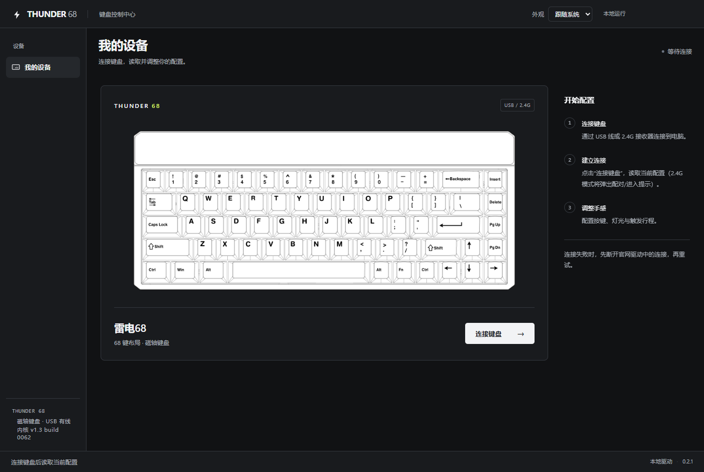

[简体中文](README.md) | [English](README.en.md)

# 雷电68 本地驱动（个人离线版）

面向达尔优雷电68（DAREU Thunder68）官方 WebHID 配置程序的个人离线 Electron 桌面伴侣外壳，提供离线隔离运行、深浅防闪屏主题工作台、USB 有线与 2.4G 无线接收器支持、本地配置方案库与差异对比、纯自研离线按键与磁轴手感校验器、热插拔排障与脱敏诊断中心、系统托盘常驻与全局快捷键。

> **合规与定位声明**：本项目并非达尔优官方发布的 Windows 驱动，也不安装或替换任何系统驱动，亦不自造底层 HID 协议发包。配置界面与底层设备通信逻辑来自 `https://oem.dareu.com/thunder68`（2026-10-06 首次同步，供个人离线使用）。公开仓库**不包含**官方前端资产，CI 与 Release 亦**绝不**同步或分发含官方资源的构建产物；详见 [THIRD_PARTY_NOTICES.md](THIRD_PARTY_NOTICES.md)。

---

## 界面预览



*离线桌面控制中心主界面（设备连接页、伴侣工具栏与深色/跟随系统主题外观）。*

---

## 快速使用（便携版）

1. 双击运行 `release/Thunder68-Local/Thunder68-Local.exe`（保持整个文件夹完整，可将整目录复制到固定目录使用；无需安装 Node.js、无需浏览器或联网）。
2. 通过 **USB 有线**或 **2.4G 接收器**连接雷电68，在界面中点击 **连接键盘**。
   - **热插拔自动感应**：未连接状态下插入 USB 线或唤醒 2.4G 键盘时，底部会弹出非侵入式「检测到雷电68 已接入 → 一键重连」浮条。
   - **精准排障与诊断中心**：若连接失败，会自动区分「未检测到设备 / 蓝牙模式不支持 WebHID / 同品牌其他型号（非雷电68） / 句柄被网页驱动或其他进程占用 / HID 通信失败」并给出对应恢复步骤；点击右上角 **连接诊断** 可打开侧滑诊断中心并一键复制脱敏日志。
   - **多设备与 2.4G 支持**：同时检测到多个雷电68 时弹出设备选择框；2.4G 无线模式下配对弹窗正常居中显示，侧栏与托盘菜单实时显示连接模式与 2.4G 电量百分比。
3. 使用官方配置页或左侧 **伴侣工具**：
   - **配置方案库**：将当前 68 键配置剥离运行态字段导出为本地快照（支持名称与 FPS/办公等场景标签），支持 JSON 导入导出、两套方案键程/RT/改键 Diff 对比，以及通过官方原生 `#fileInput` 通道一键切换（写入前自动保存回滚快照，完成后引导 **重新读取核对**）。
   - **按键与手感测试**（未连键盘亦可离线使用）：纯自研 68 键触发矩阵与 NKRO 统计、RT 连击/误触检测器（捕捉 `<15ms` / `<25ms` 同键二次触发标红，连接态同步只读展示该键行程/RT 参数）、FPS 急停 / SOCD 重叠分析器（统计 `A/D`、`W/S` 重叠时长、空窗时长与零重叠率），切离页面自动释放监听。
   - **桌面伴侣**：支持关闭窗口最小化到系统托盘、托盘右键快捷切方案、可选开机静默自启（`--minimized`，便携版建议先固定目录再开启）、全局快捷键（默认 `CommandOrControl+Alt+T` 显隐窗口）与 2.4G 低电量轻提示。

本地资料、配置方案、偏好设置与诊断日志默认保存在程序旁的 `data/` 目录（含 `preferences.json`、`profiles/*.json` 与 `diagnostics.jsonl`；若所在目录只读，自动回退到系统用户数据目录）。所有诊断日志严格脱敏，**绝不记录按键文本、个人用户名或设备序列号**。

---

## 核心功能与更新亮点

- **离线隔离与安全边界**：自定义 `thunder68://driver` 异步协议与严格 CSP 拦截全部远程网络请求；不自造底层 HID 写包协议，整机方案写入严格复用官方原生 `#fileInput`（`USER_IMPORT_WHOLE_CONFIG`）。
- **热插拔感应 + 四分类排障 + 脱敏诊断中心**：
  - 监听 `navigator.hid` `connect` / `disconnect` 事件，接入雷电68 弹出非侵入式重连浮条。
  - 透传完整 `error.name` 并结合主进程枚举结果细分为 4 类精准排障卡片；窄屏保留可折叠连接排障条；优化深色模式下快速触发页行程 SVG 徽章高反差配色。
  - 内置侧滑「连接诊断中心」，可查看 WebHID 枚举接口状态、本次会话 HID 事件计数与一键复制脱敏诊断报告。
- **本地配置方案库（快照 / Diff / 防砖校验 / 一键切换）**：
  - 从只读状态剥离运行态与设备标识字段并存储至 `data/profiles/*.json`，兼容导入方案库格式与官方原生 JSON。
  - 内置键程、RT 灵敏度、改键、灯效、超级按键、宏与系统/触发模式（回报率、休眠、游戏禁用键）差异对比；应用前执行雷电68 真实 68 键白名单、超级按键/宏子结构与数值范围防砖校验、`config.mask` 忙态守卫、HID 发包增量/断连实时监视及自动回滚快照留存。
- **纯自研离线按键测试与磁轴手感校验器**：
  - 100% 自研 68 键布局与时序引擎（不复制任何官方图片），离线即可验证 NKRO、`<15ms`/`<25ms` RT 误触连击与 `A/D`、`W/S` 急停零重叠率；连接态同步只读显示当前键行程与 RT 参数。
- **系统托盘常驻与桌面伴侣体验**：
  - 持久化主题与多屏可见窗口几何到 `data/preferences.json`，主进程启动即匹配浅/深色窗口底色与标题栏，消除浅色主题启动闪黑屏。
  - 引入自研简约图标的系统托盘（状态/电量、快捷切方案、显隐窗口、退出）、关闭最小化到托盘、开机静默自启（`--minimized`）、全局热键与 2.4G 低电滞回轻提示。
- **双语兼容与防假阳性回读核对**：
  - 完整保留中/英文标签匹配与 DOM 结构兜底、可搜索按键分配器与显式状态机驱动的「重新读取核对」。
- **工程基建与便携包瘦身**：
  - 干净环境单元测试与本地 vendor 哈希校验解耦（干净 clone 运行 `npm test` 100% 通过），接入 GitHub Actions Windows（Node 22，与 Electron 44 引擎要求对齐）CI 与静态合规守卫（确认 Git 零追踪 `app/vendor/` 与 `research/decoded.js`）。
  - `npm run build` 自动裁剪 `locales/` 中除 `zh-CN.pak` 和 `en-US.pak` 外的 53 个多余语言包（单次干净构建由 `374.00 MiB` 瘦身至 `326.83 MiB`，节省 **47.17 MiB**），完整保留所有许可证文件与 220 项资源审计门禁。

---

## 从公开仓库构建与开发

### 环境要求

- Windows
- Node.js（`Node >= 22.12.0`，与 Electron 44 引擎对齐，内置 `node:test`）与 `npm`

### 首次安装与运行

```powershell
# 1. 安装依赖（Electron ^44.5.1）
npm ci

# 2. 从官网拉取本地离线静态资源到 app/vendor/
npm run sync

# 3. 启动本地开发版
npm start
```

- **同步说明**：`npm run sync` 按 `research/asset-paths.json` 与官网引用直接从官方来源下载到本地并生成 `app/vendor/manifest.json`（含 SHA256），不依赖本机分析副本；如需强制重拉并清理过期旧文件，执行 `node scripts/sync-official.cjs --force`。
- **Electron 运行时补下载**：若首次 `npm ci` 未自动下载 Electron 运行时，可执行 `node scripts/download-runtime.cjs`（可加 `--mirror` 加速），仍以官方 `checksums.json` 校验 SHA256。

### 测试、合规检查、打包与审计

```powershell
# 运行干净环境单元测试（53 项用例，无需 app/vendor/ 即可 100% 通过）
npm test

# 静态合规守卫（确认 Git 追踪清单不含 app/vendor/、research/decoded.js 或构建产物）
npm run check:compliance

# 本地官方资产 SHA256 校验（需先执行 npm run sync）
npm run test:vendor

# 构建瘦身后的本机便携版到 release/Thunder68-Local/（裁剪多余语言包并输出体积统计）
npm run build

# 静态核验 220 项官方资源哈希、静态引用路由与 release/ 打包副本一致性（输出 output/package-audit.json）
npm run audit:package

# Electron 无头离屏自检（不弹出窗口，输出 output/self-test.json）
npx electron . --self-test --background-test
```

### 历史版本回退

重构前的早期自研源码保留在 Git 标签 `pre-ui-redesign-20261006`。保存当前修改后可执行 `git switch --detach pre-ui-redesign-20261006` 查看。Git 仅切换自研源码，本机被忽略的官方资源与资料不受影响。

---

## 已知边界与验证现状

### 功能与合规边界

- **不含远程功能**：官网内嵌的在线键盘测试（`kbtest5.driveall.cn`）、在线固件版本检查与 DFU 固件升级依赖远程服务，未包含在离线版中；固件升级请使用官方网页。
- **按键测试器的物理边界**：自研离线按键与手感测试器基于系统标准键盘事件（`KeyboardEvent.code` + `performance.now()`）分析触发、连击与急停时序，并非读取硬件 ADC 毫米级模拟行程波形。
- **不做进程注入/底层钩子**：为避免反作弊误报及未经真机验证的差量写入风险，当前版本不包含游戏进程自动切方案钩子；界面显示“已发送”本身不等于键盘固件已确认断电持久保留。

### 当前验证范围（请勿高估）

- **已验证**：53 项干净环境自动化单元测试（`npm test`）、本地官方资产 SHA256 校验（`npm run test:vendor`）、Git 静态合规检查（`npm run check:compliance`）、220 项官方资源与 238 项打包副本静态完整性审计（`npm run audit:package`，0 issues）、瘦身便携包无头启动自检与开发态无头自检（0 page errors）；以及此前已验证的深浅/系统主题、多窗口尺寸、六页导航与只读连接/核对流程。
- **尚未逐项真机写入验证**：通过方案库触发 `#fileInput` 整机导入后各项改键、灯效、触发行程/RT、宏与超级按键的实际固件持久化与断电重启行为；2.4G 无线配对与低电量实机联调回归。

---

## 更多文档与许可证

- 版本更新日志：[CHANGELOG.md](CHANGELOG.md)
- 开发架构与维护细节：[DEVELOPMENT.md](DEVELOPMENT.md)
- AI 助手与工程协作规范：[AGENTS.md](AGENTS.md)
- 第三方资源来源与版权边界：[THIRD_PARTY_NOTICES.md](THIRD_PARTY_NOTICES.md)
- 自研代码许可证：MIT（见 [LICENSE](LICENSE)）
